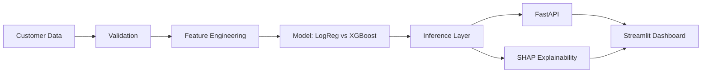

# 🛡️ ChurnGuard

**Predictive customer churn detection for FinTech.**

ChurnGuard is an end-to-end ML system that scores banking customers by churn
risk, explains *why* each customer is at risk, and surfaces that to a
retention team through a REST API and an analyst dashboard. Built as a
full-lifecycle portfolio project — data pipeline, model development, MLOps,
API, dashboard, testing, and deployment — not just a notebook.

## Problem

FinTech companies lose recurring revenue to customer churn, and retention
teams often only find out after a customer has already disengaged.
ChurnGuard flags at-risk customers early and explains the top factors behind
each risk score, so outreach can be targeted and specific rather than
generic.

## Architecture



Full architecture write-up: [`docs/architecture.md`](docs/architecture.md)

## Results

| Metric | Value |
|---|---|
| Model | Logistic Regression (best of LogReg vs. XGBoost, selected by AUC) |
| AUC-ROC | **0.80** |
| Precision @ Top 20% highest-risk | **0.69** |
| Recall | 0.72 |
| Fairness check | < 3% recall gap across salary band and channel segments |

At a Precision@Top-20% of 0.69, if the retention team contacts the top-20%
highest-risk customers ChurnGuard flags, roughly 7 in 10 of those contacts
would be reaching a customer who was actually going to churn — turning a
blind outreach effort into a targeted one.

Full metrics and methodology: [`docs/model_card.md`](docs/model_card.md)

## Features

- 🔍 **Explainable predictions** — every risk score comes with a SHAP-based
  breakdown of the top contributing factors (e.g., "declining balance,"
  "low engagement," "recent inactivity")
- ⚡ **REST API** — single, batch (JSON), and batch (CSV upload) prediction
  endpoints, plus model metadata and health checks
- 📊 **Analyst dashboard** — risk overview across the customer base,
  per-customer drill-down, and model performance view
- ✅ **Tested pipeline** — data validation, feature engineering, a model
  quality CI gate, API contract tests, and fairness checks
- 🐳 **Containerized** — Docker + Docker Compose for local or cloud deployment
- 📄 **Full documentation set** — charter, SRS, architecture doc, data
  dictionary, model card, deployment runbook (see `docs/`)

## Tech Stack

`Python` `pandas` `scikit-learn` `XGBoost` `SHAP` `FastAPI` `Streamlit`
`pytest` `Fairlearn` `Docker` `GitHub Actions`

## Quickstart

```bash
git clone <your-repo-url> && cd churnguard
pip install -r requirements.txt

python src/data_pipeline/generate_data.py   # synthetic dataset
python src/data_pipeline/validate.py        # data quality report
python src/models/train.py                  # train + select best model
pytest tests/ -v                            # run test suite

uvicorn src.api.main:app --reload --port 8000   # API on :8000
streamlit run dashboard/app.py                  # dashboard on :8501
```

Or with Docker:

```bash
docker compose up --build
```

Full setup and deployment instructions: [`docs/runbook.md`](docs/runbook.md)

## Project Structure

```
churnguard/
├── data/raw/                 # synthetic dataset
├── src/
│   ├── data_pipeline/        # generation + validation
│   ├── features/             # shared feature engineering
│   ├── models/                # training, inference, explainability
│   └── api/                   # FastAPI service
├── dashboard/                 # Streamlit analyst dashboard
├── tests/                     # pipeline, model gate, API, fairness tests
├── docs/                      # charter, SRS, architecture, data dictionary,
│                               # model card, runbook
├── .github/workflows/ci.yml   # lint → train → test → build
├── Dockerfile / Dockerfile.dashboard / docker-compose.yml
└── requirements.txt
```

## Data Note

The dataset is **synthetic**, generated with a hand-crafted, interpretable
churn signal (inactivity, declining balance, single-product customers, and
support complaints all increase churn probability, matching real-world
retention intuition). This keeps the project fully self-contained and
avoids any real customer data, while still producing a model with genuine,
learnable signal rather than noise. See `docs/data_dictionary.md` for full
schema and `src/data_pipeline/generate_data.py` for the generation logic.

## What I'd Do Next

- Swap the synthetic generator for a real (anonymized) transaction dataset
  and re-validate all fairness/performance thresholds
- Add streaming feature ingestion (e.g., Kafka) for near-real-time scoring
  instead of batch
- Add a model monitoring service (Evidently AI) with drift alerting wired
  into the retraining trigger
- Decouple the dashboard from the API (currently the dashboard imports the
  inference layer directly for simplicity; a production build would have it
  call the API over HTTP so they scale independently)
- Add authentication/RBAC to the API before any real deployment

## License

Portfolio project — feel free to reference the architecture and patterns.
