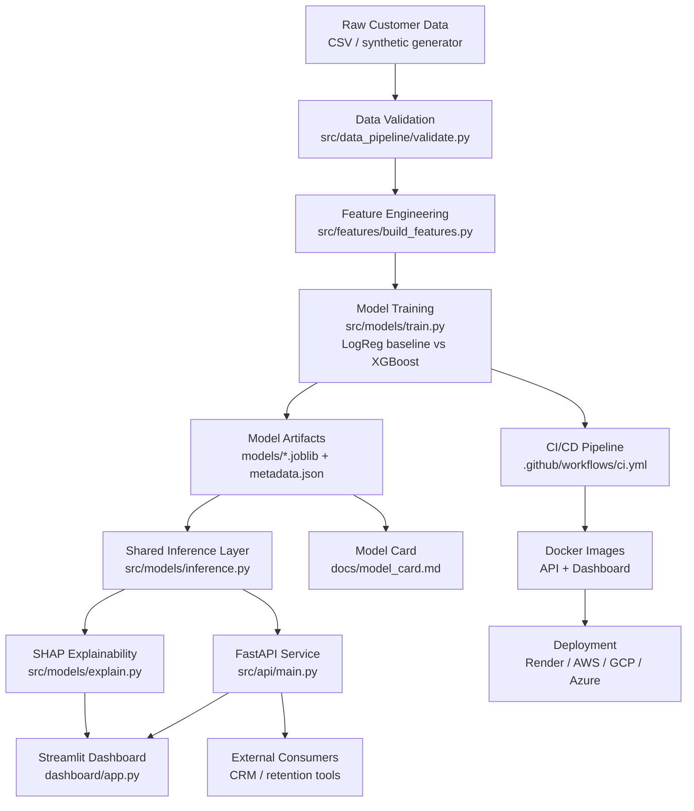

# ChurnGuard — System Architecture

## 1. Architecture Diagram



## 2. Component Responsibilities

| Component | Responsibility | Location |
|---|---|---|
| Data Generator | Produces synthetic FinTech customer dataset with realistic churn signal | `src/data_pipeline/generate_data.py` |
| Data Validator | Schema, null, range, and class-balance checks | `src/data_pipeline/validate.py` |
| Feature Builder | Converts raw data → model-ready feature matrix; single source of truth for both training and inference | `src/features/build_features.py` |
| Model Trainer | Trains baseline + candidate models, selects best by AUC, persists artifacts, writes Model Card | `src/models/train.py` |
| Inference Layer | Loads persisted artifacts; applies correct scaling per model type; used by both API and explainer to avoid train/serve skew | `src/models/inference.py` |
| Explainability | SHAP-based per-customer and global feature attribution | `src/models/explain.py` |
| API | REST interface for predictions and explanations | `src/api/main.py` |
| Dashboard | Analyst-facing UI: risk overview, customer drill-down, model performance | `dashboard/app.py` |
| Tests | Pipeline, model-quality gate, API contract, fairness checks | `tests/` |
| CI/CD | Lint → generate data → validate → train → test → build images | `.github/workflows/ci.yml` |

## 3. Key Design Decisions

1. **Single shared inference module.** Both the API and the SHAP explainer
   call through `ChurnPredictor` in `inference.py` rather than loading the
   model independently. This was a deliberate fix after an early bug where
   the explainer used unscaled features against a model trained on scaled
   inputs — centralizing this logic prevents that class of bug entirely.

2. **Model-agnostic feature schema.** `build_model_matrix()` accepts a
   `fit_encoder` flag: `True` during training (builds the column schema),
   `False` at inference (reindexes to the training-time schema, filling
   missing dummy columns with 0). This guarantees a batch with an unseen
   category doesn't silently break column alignment.

3. **SHAP background sampling.** Explaining a single row in isolation
   collapses SHAP contributions toward zero because there's no baseline to
   compare against. The explainer samples 200 real customers as a background
   reference distribution, matching standard SHAP practice.

4. **Business-relevant metric alongside statistical ones.** Precision@Top-20%
   is tracked alongside AUC/F1 because retention teams have limited outreach
   capacity — the number that matters operationally is "of the customers we
   flag as highest-risk, how many actually churn," not just overall
   discriminative power.

## 4. Deployment Topology (target)

```
                    ┌─────────────────────┐
                    │   Load Balancer /    │
                    │   Reverse Proxy      │
                    └──────────┬───────────┘
                               │
              ┌────────────────┴────────────────┐
              │                                  │
    ┌─────────▼──────────┐            ┌──────────▼──────────┐
    │  ChurnGuard API     │            │  ChurnGuard          │
    │  (FastAPI, Docker)  │◄───────────┤  Dashboard            │
    │  port 8000           │            │  (Streamlit, Docker)  │
    └─────────┬────────────┘            └───────────────────────┘
              │
    ┌─────────▼──────────┐
    │  Model Artifacts     │
    │  (models/ volume or   │
    │   baked into image)   │
    └───────────────────────┘
```

For a portfolio deployment, API + Dashboard can run as two services on a
platform like Render/Railway, or as two containers via `docker-compose up`
locally. See `docs/runbook.md` for step-by-step deployment instructions.
